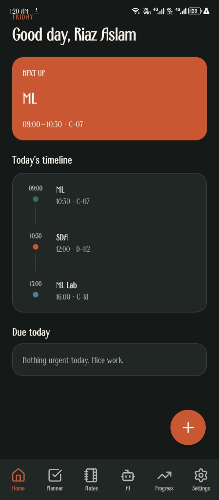
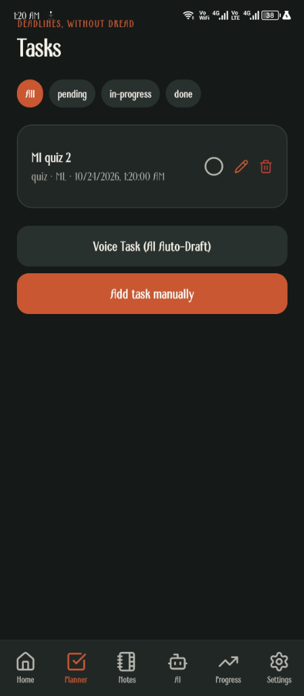
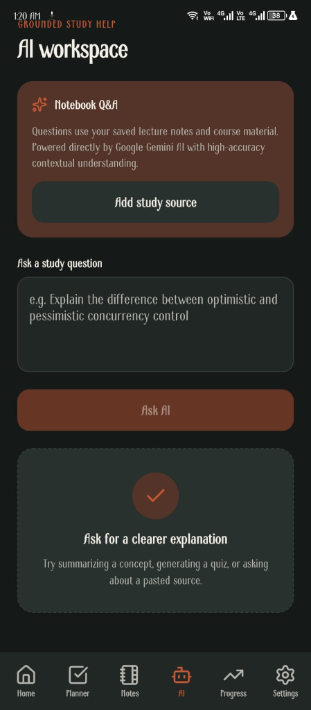
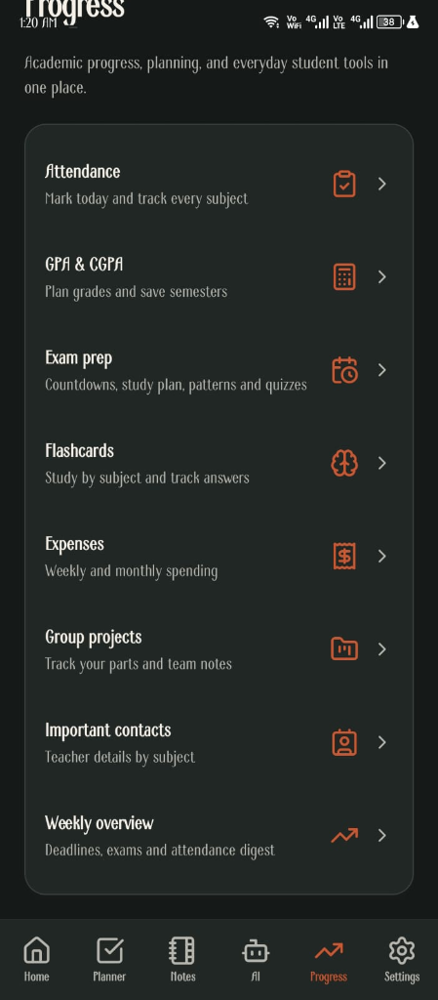
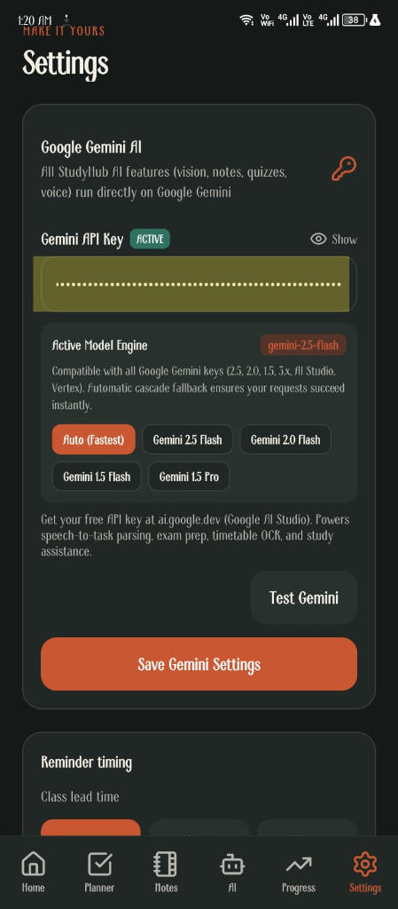

# 🎓 StudyHub — Smart Student Academic Management & AI Productivity Suite

<div align="center">


[](https://expo.dev/artifacts/eas/sWsaU_7OTsfVWXYKIt3fHG9fvYe2axRU3YJI3_-3msM.apk)
[](https://expo.dev)
[](https://reactnative.dev)
[](https://www.typescriptlang.org)
[](https://sqlite.org)
[](https://ai.google.dev)
[](LICENSE)

**An intelligent, offline-capable academic operating system designed for university and college students.**  
*Combines local SQLite persistence with Google Gemini AI for smart schedule parsing, voice task logging, and grounded exam preparation.*

[📥 Download Pitch-Ready APK](https://expo.dev/artifacts/eas/sWsaU_7OTsfVWXYKIt3fHG9fvYe2axRU3YJI3_-3msM.apk) • [Screenshots](#-app-screenshots) • [Features](#-core-features) • [Gemini Workflows](#-google-gemini-ai-features) • [Local vs. Cloud](#-local-vs-cloud-data-architecture) • [Security](#-api-key-setup--security) • [Tech Stack](#-technology-stack) • [Building APK](#-building-and-installation)

</div>

---

## 📱 App Screenshots

<div align="center">

| Dashboard & Timeline | Tasks & Voice AI | AI Workspace (Gemini) | Academic Hub | Settings & Model Engine |
| :---: | :---: | :---: | :---: | :---: |
|  |  |  |  |  |
| **Next Class & Schedule** | **Voice Task & Priorities** | **Grounded Q&A Study Help** | **GPA, Exams & Attendance** | **Google Gemini Engine** |

</div>

---

## 💡 The Problem StudyHub Solves

University students balance dozens of moving targets across 5 to 7 demanding courses every semester:
1. **Scattered Information**: Timetables are buried in PDF matrices, tasks live on whiteboards or group chats, notes are fragmented across gallery screenshots, and attendance policies are difficult to track manually.
2. **Subscription Fatigue & Cloud Lock-In**: Most productivity apps force students into monthly recurring subscriptions, mandate cloud account registration, and degrade when an internet connection drops in campus basements or lecture halls.
3. **Friction in Task Entry**: Typing full assignment details between lectures is tedious. Students either forget deadlines or delay tracking them altogether.
4. **Attendance Anxiety**: Missing mandatory minimum attendance thresholds (such as 75% or 80%) leads to sudden course drops and exam barring without advance warning.

**StudyHub solves this with a unified, high-reliability mobile experience:**
- **Zero Required Cloud Backend**: All core academic records—timetables, notes, attendance logs, tasks, and budgets—run on an embedded SQLite database that operates 100% offline.
- **On-Demand AI Acceleration**: When connected to the internet, Google Gemini automates timetable extraction, voice task creation, transcript OCR, and exam study planning.

---

## 🚀 Core Features

### 📚 Academic Management (Offline-Capable)

- **Interactive Dashboard**: Real-time overview of current semester progress, next upcoming lecture, overdue and pending deadlines, attendance warnings, and quick shortcuts.
- **Weekly Timetable Matrix**: Schedule classes across all weekdays with start/end times, instructor names, and classroom numbers. Automated notification reminders fire 5 minutes before each lecture.
- **Post-Class Prompts**: Automated notifications 5 minutes after each lecture asking students to record their attendance and check for new homework, quizzes, or assignments given in class.
- **Manual & Counter Attendance Tracking**: Direct editing of `Present`, `Absent`, and `Cancelled` lecture counts. Features real-time percentage recalculation, safe-to-miss margins, and minimum threshold alerts (default 75%).
- **Notion-Style Block Notes**: Modular rich-text editor supporting headings, paragraphs, bullet lists, numbered lists, interactive checklists, code blocks, and horizontal dividers.
- **Multimodal File Attachments**: Attach lecture PDFs, slides, documents, and whiteboard snapshots directly to notes with local file-system caching.
- **Task & Assignment Tracker**: Track assignments, quizzes, exams, and todos with priority levels (`high`, `medium`, `low`) and status filters (`pending`, `done`).
- **Recurring 3-Hour Deadline Reminders**: For pending assignments, quizzes, and exams with deadlines, StudyHub triggers recurring notifications every 3 hours until completed.
- **GPA & CGPA Calculator**: Semester-by-semester GPA tracking distinguishing between expected and actual grades, with full CGPA progression curves.
- **Student Expense & Budget Tracker**: Log daily campus expenses across food, transport, hostel/mess, and academics with visual expenditure charts.
- **Complete Data Portability**: One-click JSON backup export and restore mechanism to preserve user data when upgrading devices.

---

### 🤖 Google Gemini AI-Assisted Workflows

Google Gemini is the **sole, dedicated AI provider** powering StudyHub's intelligent features:

| AI Feature | Model Capability | User Experience / Guardrails |
| :--- | :--- | :--- |
| **Timetable Image OCR** | Multimodal Vision | Upload a syllabus or photo of a classroom schedule. Gemini parses weekdays, times, courses, instructors, and rooms into structured data. Students review and edit all fields in an interactive confirmation screen before saving. |
| **Voice Note → Task Creation** | Audio Transcription + Gemini Interpretation | Speak naturally via device microphone. StudyHub captures speech into an **editable text box** so students can adjust speech typos. Gemini resolves relative deadlines (*"next Tuesday at 4 PM"*), maps to enrolled courses, and extracts priority. Requires user confirmation before adding to tasks. |
| **Transcript & Grade OCR** | Multimodal Vision | Snap a photo of an official university transcript or exam result card. Gemini extracts course codes, credit hours, and earned letter grades directly into semester calculations. |
| **Document & Handout OCR** | Multimodal Vision | Extract printed or handwritten text from lecture slides, whiteboards, and handouts directly into editable note blocks. |
| **AI Flashcard Decks** | Structured JSON Generation | Generate spaced repetition question-and-answer study cards for any uploaded lecture topic or note block. |
| **10-Question Mock Quizzes** | Strict Schema Validation | Generates university-level multiple-choice questions for any revision topic with 4 choices and validated answer keys. |
| **Grounded AI Study Assistant** | Grounded RAG Prompting | Ask complex academic questions with context loaded from saved lecture source texts. |
| **Exam Strategy & Revision Plan** | Contextual Planning | Analyzes upcoming exam dates and syllabus coverage to generate prioritized daily revision checklists. |

---

## 🔒 Local vs. Cloud Data Architecture

StudyHub maintains a clear and transparent separation between **local storage** and **cloud AI processing**:

```
┌────────────────────────────────────────────────────────────────────────┐
│                              StudyHub App                              │
│             React Native 0.81 • Expo SDK 54 • TypeScript               │
├────────────────────────────────────┬───────────────────────────────────┤
│         LOCAL STORAGE LAYER        │        CLOUD AI REQUESTS          │
│       (100% Offline Capable)       │     (Internet & Key Required)     │
├────────────────────────────────────┼───────────────────────────────────┤
│ • SQLite Database (`studyhub.db`)  │ • Google Gemini Cloud API         │
│   - Timetable slots & courses      │ • Multimodal image OCR            │
│   - Attendance records & counts    │ • Speech transcript parsing       │
│   - Notes, blocks & checklists     │ • Quiz & flashcard generation     │
│   - Tasks, exams & expenses        │ • Study assistant queries         │
│ • Local File System attachments    │                                   │
│ • Android Exact Alarm notifications│                                   │
│ • Hardware SecureStore credentials │                                   │
└────────────────────────────────────┴───────────────────────────────────┘
```

> [!IMPORTANT]
> **Data Privacy & Cloud Transparency**:
> 1. **Academic records are stored locally on your device**: All subjects, timetable schedules, attendance counts, note text, and expenses are persisted in local SQLite. They are never sent to any third-party analytics or synchronization servers.
> 2. **AI features require network access and send prompt payloads to Google Gemini**: When you use timetable scanning, voice task extraction, OCR, or quizzes, the relevant image, transcript, or topic text is sent directly to Google Gemini's cloud endpoints (`generativelanguage.googleapis.com`).
> 3. **No false offline AI claims**: StudyHub does not run on-device LLMs. When offline, all core academic features (dashboard, notes, attendance, timetable, alarms, expenses, GPA) work flawlessly, while AI-dependent buttons gracefully notify the user that an internet connection is required.

---

## 🔑 API-Key Setup, Model Compatibility & Security

### 1. Generating Your Google Gemini API Key
1. Go to [Google AI Studio](https://aistudio.google.com/).
2. Sign in with your Google account and click **Get API key** → **Create API key**.
3. Select an existing Google Cloud project or click **Create API key in new project**.
4. Copy the generated API key (format: `AIzaSy...`).

### 2. Supported Model Hierarchy & Compatibility
Google AI Studio regularly updates model availability for new users while maintaining active endpoints for existing projects. StudyHub incorporates an intelligent, controlled model fallback engine that handles these differences seamlessly:

| Priority | Model Identifier | Tier & Purpose | Availability Status |
| :--- | :--- | :--- | :--- |
| **1 (Primary)** | `gemini-3.8-flash` | High-intelligence multimodal workhorse | Standard default for new Google AI Studio keys |
| **2 (Fallback)**| `gemini-3.5-flash-lite`| High-throughput, low-latency reasoning | Active fallback for lightweight/fast tasks |
| **3 (Fallback)**| `gemini-2.5-flash` | Multimodal Flash with built-in thinking | Preserved for existing accounts; falls back gracefully if restricted |
| **4–6 (Legacy)**| `gemini-2.0-flash`, `gemini-1.5-flash`, `gemini-1.5-pro` | Stable production models | Long-standing fallback options for older keys |

### 3. Controlled Fallback & Security Architecture
- **Dual Authentication**: StudyHub transmits credentials via both the secure `x-goog-api-key` HTTP header and standard query parameters, complying with Google's latest API authentication specifications.
- **Graceful Deprecation Handling**: If Google returns `models/gemini-2.5-flash is no longer available to new users. Use models/gemini-3.8-flash.` or HTTP 404, StudyHub automatically switches to the next verified model in the priority hierarchy and caches the working model for subsequent requests.
- **Non-Model Error Guard**: StudyHub never blindly switches models on permanent errors:
  - `401 AUTH_INVALID_KEY`: Immediately informs the user to check their key in Settings without cycling models.
  - `403 PERMISSION_DENIED`: Immediately alerts the user to check project permissions in Google AI Studio.
  - `429 QUOTA_EXHAUSTED`: Alerts the user of rate limiting without triggering unnecessary retries.
- **Transient Network Retries**: Built-in bounded retries with exponential backoff on HTTP 500–504 or network disconnects.
- **Key Masking & Zero Secret Leakage**: All logs and error messages strictly mask keys (`AIza...XXXX`). Keys are stored locally using hardware-backed encryption via `expo-secure-store` (Android Keystore / iOS Keychain).

### 4. Troubleshooting Common Gemini Errors
- **`Invalid Gemini API key` (HTTP 401)**: The key entered in Settings is expired or incorrect. Copy a fresh key from [Google AI Studio](https://aistudio.google.com/).
- **`Permission Denied` (HTTP 403)**: Ensure that the **Generative Language API** is enabled in the Google Cloud project associated with your API key.
- **`Rate limit or quota exceeded` (HTTP 429)**: Free-tier AI Studio keys have per-minute request quotas. Wait 15–30 seconds before submitting another request.
- **`Model unavailable` (HTTP 404 / 400)**: StudyHub's fallback engine automatically selects the next supported model (`gemini-3.8-flash` → `gemini-3.5-flash-lite` → `gemini-2.5-flash`).

### 5. Configuring Key in StudyHub
1. Open StudyHub → Navigate to **Settings** (`⚙️`).
2. Paste your key into the **Gemini API Key** field.
3. Tap **Test Gemini** to verify connectivity (the app will test and report the active model).
4. Tap **Save Gemini Key**.

---

## 💻 Technology Stack

- **Framework**: [React Native](https://reactnative.dev/) (0.81.5) with [Expo SDK](https://expo.dev/) (~54.0.37)
- **Language**: [TypeScript](https://www.typescriptlang.org/) (5.9.2) with strict typechecking
- **Navigation**: [React Navigation 7](https://reactnavigation.org/) (Bottom Tabs + Native Stack)
- **Local Database**: [expo-sqlite](https://docs.expo.dev/versions/latest/sdk/sqlite/) (Embedded SQLite with schema migrations)
- **State Management**: [Zustand](https://github.com/pmndrs/zustand) (Persistent preferences & lightweight store)
- **Audio & Speech**: `expo-speech-recognition` (Native on-device speech-to-text recognition)
- **Notifications**: `expo-notifications` (Exact alarms, 3-hour task intervals, class reminders)
- **Secure Storage**: `expo-secure-store` (Hardware-backed encrypted storage for API credentials)
- **File & Media Handling**: `expo-file-system`, `expo-image-picker`, `expo-image-manipulator`, `expo-document-picker`, `expo-sharing`
- **Icons & Design**: `lucide-react-native`, custom editorial theme system with light/dark support
- **AI Engine**: Google Gemini API (`gemini-3.8-flash`, `gemini-3.5-flash-lite`, `gemini-2.5-flash` with controlled fallback)

---

## 📂 Project Structure

```
StudyHub/
├── assets/                          # App icons, splash screens, and static branding
├── src/
│   ├── screens/                     # UI Screen components
│   │   ├── AiScreen.tsx             # AI Workspace & grounded Notebook Q&A
│   │   ├── AttendanceScreen.tsx     # Attendance tracking, counter editing & catch-up math
│   │   ├── DashboardScreen.tsx      # Semester overview, next class & quick actions
│   │   ├── ExamPrepScreen.tsx       # Exam countdown, daily revision plan & paper patterns
│   │   ├── ExpensesScreen.tsx       # Student budget & categorized expense tracking
│   │   ├── FlashcardsScreen.tsx     # Spaced repetition study decks & AI deck generator
│   │   ├── GpaScreen.tsx            # GPA/CGPA calculator & transcript OCR
│   │   ├── MockQuizScreen.tsx       # 10-question practice mock quizzes with instant scoring
│   │   ├── NotesScreen.tsx          # Notion-style block editor, checklists & attachments
│   │   ├── OnboardingScreen.tsx     # Welcome flow & semester setup
│   │   ├── SettingsScreen.tsx       # Gemini API key, notification preferences & DB backup
│   │   ├── TasksScreen.tsx          # Task list, priority filters & voice-to-task modal
│   │   ├── TimetableReviewScreen.tsx# Editable review screen for AI-extracted timetable slots
│   │   ├── TimetableScreen.tsx      # Weekly timetable matrix & manual class creation
│   │   └── WeeklyOverviewScreen.tsx # Weekly digest of tasks, exams, and attendance
│   ├── ai.ts                        # Google Gemini client, vision OCR & structured prompting
│   ├── components.tsx               # Reusable UI primitives (Screen, Card, Button, Input, Sheet)
│   ├── db.ts                        # SQLite database initialization, migrations & queries
│   ├── navigation.tsx               # Bottom tabs & stack navigators
│   ├── notifications.ts             # Local notification scheduling engine
│   ├── store.ts                     # Zustand persistent UI state
│   ├── theme.ts                     # Color palette, spacing tokens & light/dark theme
│   ├── types.ts                     # TypeScript domain models & database interfaces
│   └── voice.tsx                    # Speech recognition microphone button component
├── app.json                         # Expo application configuration & native plugins
├── eas.json                         # EAS build profiles (preview APK, production)
├── package.json                     # Pinned dependencies & development scripts
├── tsconfig.json                    # TypeScript compiler configuration
└── README.md                        # Project documentation
```

---

## 🛠️ Installation & Local Development

### Prerequisites
- [Node.js](https://nodejs.org) (v18 or v20 LTS recommended)
- [npm](https://www.npmjs.com/) or [yarn](https://yarnpkg.com/)
- [Android Studio](https://developer.android.com/studio) or a physical Android device

### Setup Instructions
1. **Clone the repository**:
   ```bash
   git clone https://github.com/riazaslam029/StudyHub.git
   cd StudyHub
   ```

2. **Install dependencies**:
   ```bash
   npm install
   ```

3. **Verify code quality & project health**:
   ```bash
   npm run typecheck    # Verifies zero TypeScript errors (tsc --noEmit)
   npm run lint         # Verifies zero ESLint warnings or errors
   npx expo-doctor      # Runs Expo configuration and dependency health checks
   ```

4. **Start development server**:
   ```bash
   npm start
   ```

> [!NOTE]
> **Expo Go Limitation**: StudyHub relies on custom native modules (including `expo-sqlite`, `expo-speech-recognition`, and `expo-notifications` exact alarms). Because of these native dependencies, running in standard Expo Go is limited; run on a connected Android device or emulator using a development build:
> ```bash
> npx expo run:android
> ```

---

## 📱 Building and Installation

### 📥 Direct APK Download (Pitch Ready)
You can directly download and install the pitch-ready standalone APK package:
- **Direct APK Download**: [Download StudyHub APK](https://expo.dev/artifacts/eas/sWsaU_7OTsfVWXYKIt3fHG9fvYe2axRU3YJI3_-3msM.apk)
- **EAS Build Dashboard**: [View Verified Build on Expo EAS](https://expo.dev/accounts/riaz7/projects/studyhub/builds/cea5d697-3d6e-4a59-bdef-cc5207b5115a)

### 🔨 Building Standalone Android APK with EAS
StudyHub is preconfigured with an EAS build profile for creating standalone `.apk` files without needing Android Studio installed locally:

1. Install EAS CLI globally:
   ```bash
   npm install -g eas-cli
   ```

2. Login to your Expo account:
   ```bash
   eas login
   ```

3. Trigger a standalone Android preview build:
   ```bash
   eas build --platform android --profile preview
   ```
   *EAS generates an installable `.apk` file that can be downloaded and installed directly on any Android device.*

---

## 🧪 Verification & Audit Status

StudyHub has undergone a comprehensive code audit to ensure stability, clean architecture, and competition pitch readiness:

| Check | Tool / Command | Status | Notes |
| :--- | :--- | :--- | :--- |
| **Gemini Compatibility** | `npm run test:gemini` | ✅ Passed (16/16) | Verified model hierarchy, controlled fallback, error categorization & zero secret leakage |
| **Type Checking** | `npm run typecheck` | ✅ Passed (0 errors) | Strict TypeScript validation across all screens and services |
| **Code Linting** | `npm run lint` | ✅ Passed (0 issues) | Clean ESLint verification with zero warnings or errors |
| **Expo Health** | `npx expo-doctor` | ✅ Passed (18/18 checks) | All plugins, package versions, and dependencies aligned |
| **AI Architecture** | Audit `src/ai.ts` | ✅ Verified | Google Gemini is the sole AI provider; all Groq references removed |
| **Privacy / Location** | Codebase Audit | ✅ Verified | Zero location/GPS code; `expo-location` and location permissions removed |
| **Database Schema** | SQLite Migration v5 | ✅ Verified | Backward-compatible schema preservation with transactional safety |

---

## 🏆 University Pitch Presentation Summary

### Target Audience
Undergraduate and graduate university/college students seeking an organized, low-friction academic companion that respects their privacy and works anywhere on campus.

### Key Value Propositions
1. **Always Reliable**: Instant SQLite response times; lecture timetables, notes, checklists, and attendance never depend on cloud connectivity.
2. **High-Conversion AI Utilities**: AI is applied where manual entry is most painful (scanning weekly timetables from photos, voice task logging, and lecture OCR).
3. **Student Guardrails**: AI never acts as a black box—every parsed schedule and voice task requires human review and confirmation before touching the local database.
4. **Attendance Risk Protection**: Proactive math models calculate catch-up classes and safe absences to protect students from academic penalties.

---

## 📄 License

StudyHub is licensed under the [MIT License](LICENSE).

<div align="center">
  <sub>Engineered with care for students worldwide • Lead Developer: <a href="https://github.com/riazaslam029">Riaz Aslam</a></sub>
</div>
